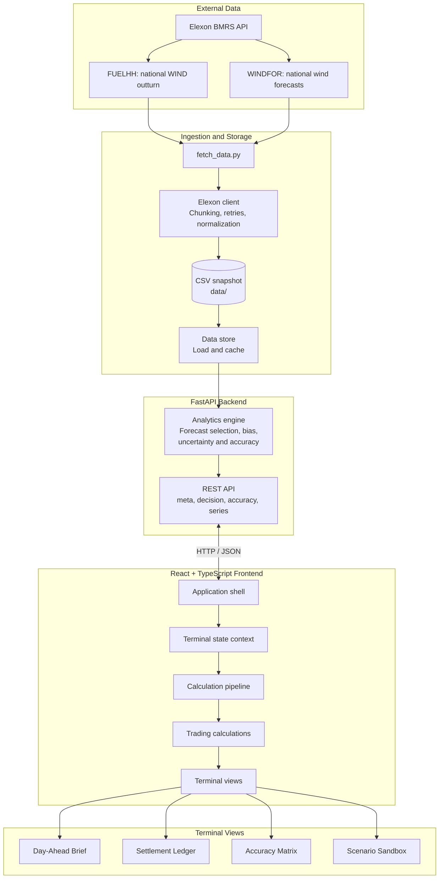
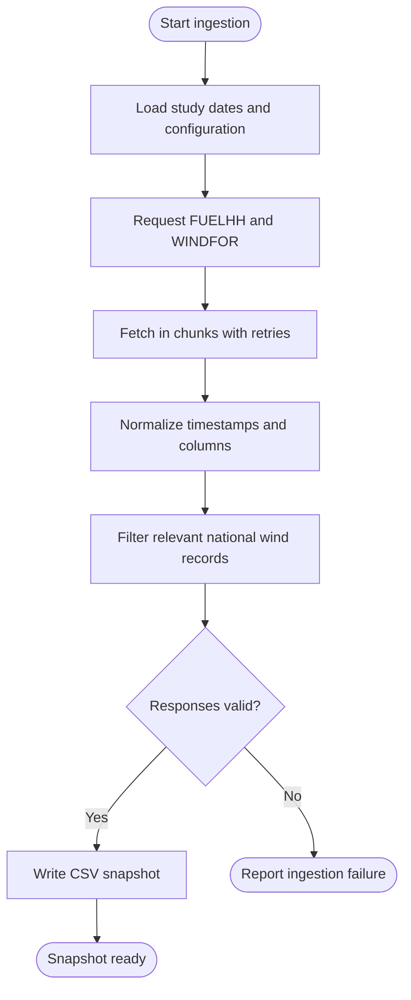
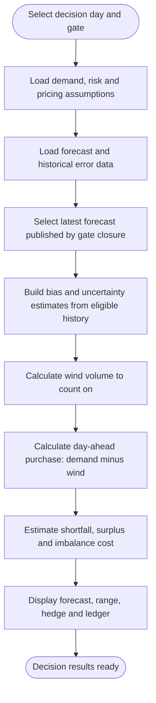
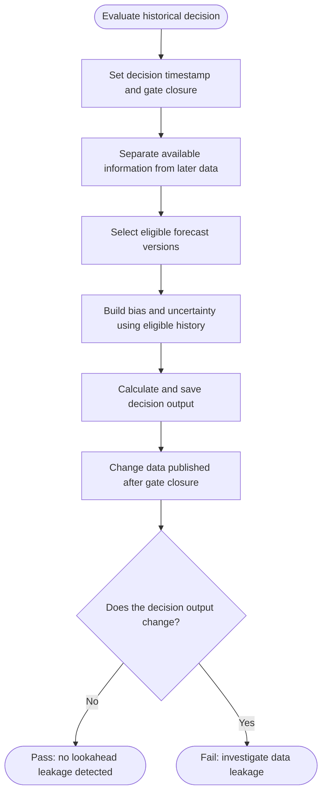
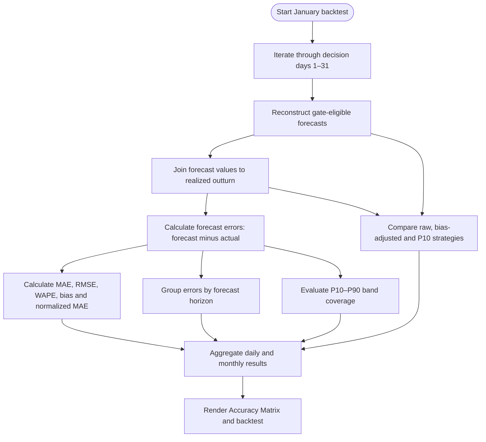
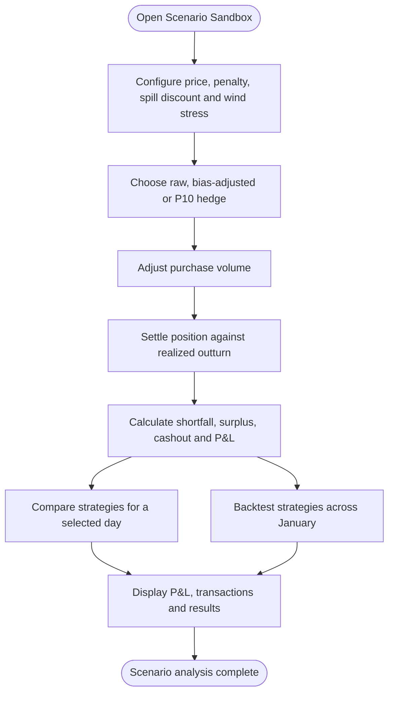
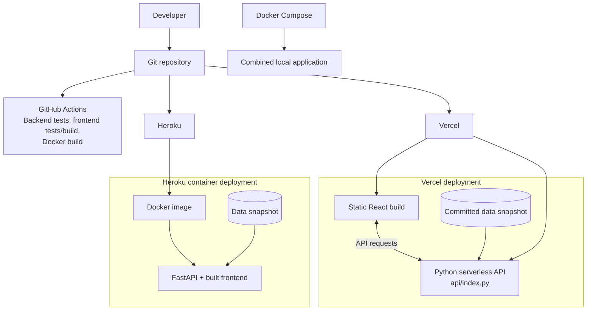

# Wind Matrix

A web app for a UK utility's day-ahead power desk. It answers two questions for every purchase decision made in January 2026:

1. **What is the latest wind forecast I can use right now?** For a chosen decision day and gate closure time, it shows the most recent national wind forecast published before gate closure for the whole next delivery day, with an uncertainty range, a bias-adjusted figure, and the volume left to buy against demand.
2. **How far can I trust it?** It measures how accurate those gate-closure forecasts were across all 31 January decisions, and how forecast error grows with horizon from 0 to 48 hours.

**Data sources:** Elexon BMRS, national level only. Outturn comes from [FUELHH](https://bmrs.elexon.co.uk/api-documentation/endpoint/datasets/FUELHH/stream) (`fuelType = WIND`) and forecasts from [WINDFOR](https://bmrs.elexon.co.uk/api-documentation/endpoint/datasets/WINDFOR/stream).

- **Live deployment:** [Wind Matrix on Vercel](https://wind-matrix.vercel.app/)
- **Deployment platform:** [Vercel](https://vercel.com/)


---

## Table of Contents

- [Quick Start](#quick-start)
- [System Architecture and Workflows](#system-architecture-and-workflows)
- [Using the Terminal](#using-the-terminal)
- [Requirements and How the App Meets Them](#requirements-and-how-the-app-meets-them)
- [Findings from January 2026](#findings-from-january-2026)
- [Method and Assumptions](#method-and-assumptions)
- [Repository Layout](#repository-layout)
- [API](#api)
- [Testing](#testing)
- [Deployment](#deployment)

---

## Quick Start

### With Docker (recommended)

```bash
docker compose up --build
```

Open [http://localhost:8000](http://localhost:8000). If you skip the fetch step, the app downloads data from Elexon on its first request (about 30 to 60 seconds) and caches it in `./data`.

To create the snapshot ahead of time:

```bash
pip install -r requirements.txt
python backend/scripts/fetch_data.py
```

### Without Docker

Requires Python 3.11+ and Node 20.19+.

```bash
# Backend
python -m venv .venv
source .venv/bin/activate
# Windows: .venv\Scripts\activate
pip install -r backend/requirements-dev.txt
python backend/scripts/fetch_data.py
cd backend
uvicorn app.main:app --reload --port 8000
```

In a second terminal:

```bash
cd frontend
npm install
npm run dev
```

Open [http://localhost:5173](http://localhost:5173). The Vite dev server proxies `/api` to port 8000. API docs are at [http://localhost:8000/docs](http://localhost:8000/docs).

### Tests

```bash
cd backend && pytest
cd frontend && npm test
```

The README's current test suite reports 26 backend tests and 31 frontend tests. Test counts may change as tests are added.

---

## System Architecture and Workflows

### 1. High-Level Architecture

The application separates external data ingestion, data storage, analytics, the REST API, and the interactive React terminal.



### 2. Data Ingestion Workflow



- **FUELHH** provides half-hourly metered generation filtered to `fuelType = WIND`.
- **WINDFOR** provides published national wind forecasts and their publication/target timestamps.
- The CSV snapshot supports repeatable analysis and reduces unnecessary API calls.

### 3. Day-Ahead Decision Workflow

For decision day D, the app selects the latest forecast published by the chosen gate closure for delivery day D+1.



**Core calculations**

- **Wind counted on:** hedge forecast minus risk fraction multiplied by the difference between the hedge forecast and P10. At 0% risk, the calculation relies on the forecast; at 100%, it relies on the P10 floor.
- **Day-ahead buy:** demand minus wind counted on, unless the trader overrides contracted volume.
- **Expected imbalance cost:** expected shortfall multiplied by the assumed penalty, plus expected surplus multiplied by the spill discount.

Demand, prices, penalties and spill discounts are configurable assumptions, not additional external datasets.

### 4. No-Lookahead Guarantee

A forecast is eligible for a decision only when its publication timestamp is at or before gate closure. Later observations may score the decision but must not influence it.



The backend no-lookahead regression test changes data published after gate closure and verifies that the decision output does not change.

### 5. Forecast Accuracy Workflow



The analysis includes error magnitude and direction, horizon performance, uncertainty-band coverage, daily energy misses, and strategy comparisons under configurable price assumptions.

### 6. Scenario Sandbox Workflow



Scenario results are simulations, not executed electricity trades. Demo jitter is simulated data, not a live forecast update.

### 7. Deployment Architecture



- **Docker:** runs the application locally.
- **Vercel:** serves the React build and exposes FastAPI through `api/index.py`. Commit the data snapshot to avoid a full Elexon fetch during a cold start.
- **Heroku:** builds and runs the Docker image using `heroku.yml`.
- **CI:** runs backend tests, frontend tests/build and a Docker build.

### 8. Key Design Principles

| Principle | Implementation |
| --- | --- |
| Temporal correctness | Forecasts are selected by publication timestamp and gate closure. |
| Separation of concerns | Ingestion, analytics, API, frontend state and trading calculations have separate modules. |
| Reproducibility | A CSV snapshot supports repeatable historical analysis. |
| Testability | Backend and frontend logic have dedicated automated tests. |
| Configurable risk | Demand, risk tolerance and pricing assumptions can be adjusted independently of source data. |
| Transparent assumptions | Measurements, forecasts, user inputs and simulated scenarios are distinguished. |
| Deployment flexibility | Docker, Vercel and Heroku configurations are included. |

---

## Using the Terminal

Four views are switched with **H** or the breadcrumb. Routes use `#/terminal/<view>/<decision-day>`.

| View | Purpose |
| --- | --- |
| **Day-Ahead Brief** | Gate-closure screen with P50, P10, P90, bias-adjusted wind, wind to count on, day-ahead buy, expected imbalance cost, generation profile and compact ledger. |
| **Settlement Ledger** | All 48 settlement periods grouped into overnight, peak and late blocks. Forecast and contracted cells are editable; rows can be repriced or auto-balanced. |
| **Accuracy Matrix** | January WAPE, bias, band hit rate, imbalance loss with/without bias adjustment, horizon table, error split and delivery-day summary. |
| **Scenario Sandbox** | Price scenario, penalty, wind ramp-down event, purchase-volume adjustment, P&L, strategy comparison, cashout transactions and January backtest. |

### Keyboard shortcuts

| Key | Action |
| --- | --- |
| `F1` | Open the full list |
| `F2` | Select date |
| `F3` | Select gate: 09:20, 09:50, 11:00 or 12:00 |
| `F4` | Recalculate |
| `F5` | Toggle 48 settlement periods / 24 hours |
| `F6` | Apply 20% wind stress |
| `F7` | Toggle raw / bias-adjusted hedge |
| `F8` | Export CSV |
| `B` | Change basis: MWh, capacity factor or £ |
| `Z` | Change risk |
| `O` | Show actuals |
| `M` | Toggle demo jitter |
| `L` | Save scenario |
| `F12` | Configure settings |
| `Alt+G` | Go to |
| `↑ ↓ Enter` | Move and drill down |
| `← →` | Move between tiles |
| `Esc` / `Q` | Go back |

Browsers reserve some function keys, particularly F12. Each shortcut also has a clickable UI equivalent.

### Running a calculation

The terminal opens empty, with placeholder figures and ledger rows. Select a decision day, or press **F4**, **Enter**, or **Execute Calculation**.

The interface stages the result in four steps: headline figures, charts, ledger rows and a READY line. The staging is presentation only. Data loads in tens of milliseconds and calculations take under one millisecond under the documented setup. The READY line reports measured timings, computed rows, browser JS heap where available, and a no-lookahead check.

Use **F12 → Reveal results → Instant** to disable staging, or **Reset terminal to empty state** to return to the opening screen. The pipeline is implemented in `frontend/src/pipeline.ts`.

**Live Recalc** applies input changes immediately. Turn it off to stage multiple changes, then use Recalc or F4.

### Trading calculations

- Wind counted on = hedge forecast − risk × (hedge forecast − P10).
- Contracted volume = demand − wind counted on, unless manually edited.
- Expected shortfall assumes outturn is normally distributed around the bias-adjusted forecast, with spread derived from P10 to P90.
- Expected imbalance cost = shortfall × penalty + surplus × spill discount.
- The sandbox settles each strategy against realized outturn. Short volume costs the day-ahead price plus penalty; surplus is sold at the day-ahead price minus the spill discount.
- Forecasts are hourly. The 48-settlement-period view interpolates them to half-hours. Outturn is half-hourly.

---

## Requirements and How the App Meets Them

| Requirement | Where it is met |
| --- | --- |
| Understand how much power must be procured beyond wind | Day-Ahead Brief shows wind to count on and the day-ahead buy. Settlement Ledger shows each settlement period. |
| Decisions are made one day before delivery | Each decision day D buys for D+1, from 00:00 to 24:00 UK time. |
| Show the latest forecast available at decision time | Day-Ahead Brief selects the latest WINDFOR value published at or before gate closure, using `latest_forecasts()` in `analytics.py`. Actuals are hidden unless requested. |
| Quantitatively evaluate forecast accuracy | Accuracy Matrix reports WAPE, MAE, RMSE, bias, normalized MAE, 1-in-10 miss, daily energy miss and horizon error. |
| Use quantified error to inform decisions | Bias adjustment, P10-based risk control and P10–P90 uncertainty inform the hedge. The January backtest compares strategies. |
| Use only FUELHH (WIND) and WINDFOR for January decisions | `elexon.py` and `store.py` handle the source data. No other external data source is used. |
| React frontend, Python backend, Docker and deployment configuration | React + TypeScript (Vite), FastAPI + pandas, Docker, Vercel and Heroku configuration. |

### Added beyond the brief

| Addition | Reason |
| --- | --- |
| Default gate closure of 09:50 UK | Represents the selected GB day-ahead auction cutoff; it is adjustable because internal cutoffs can differ. |
| P10–P90 likely range | Represents uncertainty instead of relying on a single forecast value. |
| Bias-adjusted forecast | Uses error from the previous 14 days to correct a systematic offset. |
| Earlier forecast runs | Shows how the forecast changed between publications. |
| Actuals hidden by default | Avoids mixing hindsight with the information available at decision time. |
| Error by hour, distribution and daily energy misses | Provides additional views of forecast quality for different readers. |
| Terminal-style UI and keyboard navigation | Provides a dense desk-oriented interface, based on `docs/TALLY_TERMINAL_REDESIGN_SPEC.md`. |
| Risk, demand and pricing controls | Converts wind forecasts into configurable procurement and cost estimates. |
| Editable Settlement Ledger | Allows traders to override period-level forecast or contracted volume. |
| Scenario Sandbox and January backtest | Compares hedging strategies against actual outturn under chosen assumptions. |
| Demo jitter | Supports demonstrations with clearly marked simulated values. |
| Mid-December error history | Supplies the 14-day history required for early-January bias and uncertainty estimates; it is not included in January scoring. |

---

## Findings from January 2026

At 09:50 gate closure, over the 31 January decisions, the analysis reported:

- The forecast missed by **about 2.0 GW per hour on average**, around 18% of average wind output. RMSE was 2.5 GW, and one hour in ten missed by more than 4.2 GW.
- The error was mostly one-directional: the forecast ran 1.7 GW above outturn on average, and wind under-delivered on 27 of 31 delivery days.
- Lead time mattered less than the bias. The 24-hour-ahead miss (1.93 GW) was only modestly worse than the 1-hour-ahead miss (1.68 GW); consecutive runs differed by about 0.3 GW on average.
- Correcting for the bias observed over the previous 14 days, using information available at gate closure, reduced the average miss to **1.48 GW (26% lower)** and the median daily energy miss from 13.0% to 7.4%.
- The 80% likely range contained outturn 80% of the time in this January evaluation.

A possible explanation, not tested here, is that FUELHH records metered output, which may be reduced when wind farms are turned down for network constraints, while forecasts may represent generation before those actions. Confirming this would require data outside the project's scope.

These are results reported by the project's analysis and should be revalidated against the generated data snapshot before being used operationally.

---

## Method and Assumptions

| Topic | Choice |
| --- | --- |
| Decision days | 1–31 January 2026 (UK dates). Each decision buys for the next day, so deliveries run 2 January to 1 February. |
| Gate closure | 09:50 UK by default. Adjustable in the UI. |
| Delivery day | 00:00–24:00 UK time on D+1. |
| Forecast for a decision | Latest WINDFOR value for each target time published at or before gate closure. |
| Forecast at horizon *h* | For target time *T*, select the latest forecast published at or before *T − h*. |
| Horizon cap | Forecasts more than 48 hours ahead of target are ignored; forecasts published after target are dropped. |
| Error sign | Error = forecast − actual. Positive error means wind came in below forecast, so a buyer relying on it is short. |
| Bias adjustment | Mean error from the same 14-day, ±3-hour lead-time history, subtracted from each forecast value. |
| Likely range | Empirical 10th and 90th percentiles of errors from the previous 14 days, at lead times within ±3 hours of the target lead, using only information available at gate closure. |
| Joining | Forecasts are matched to outturn on `startTime`. Outturn republications keep the latest value. |
| Data window | Outturn from 15 December 2025 and forecasts from 13 December 2025 feed the early-January error history. Later data is used only for scoring, not for decisions. |
| Daily low/high energy | Sum of hourly P10 or P90 values. This assumes every hour lands at the same end of its range, so it is a deliberately wide bound. |

The no-lookahead rule is tested in `backend/tests/test_no_lookahead.py`, which changes data published after gate closure and checks that the decision output does not change.

---

## Repository Layout

```text
.
├── api/
│   └── index.py                 # Vercel serverless entry point
├── backend/
│   ├── app/
│   │   ├── config.py            # Study window, gate and analysis settings
│   │   ├── elexon.py            # Elexon client, retries and normalization
│   │   ├── store.py             # CSV loading, fetching and caching
│   │   ├── analytics.py         # Forecast selection, uncertainty and metrics
│   │   └── main.py              # FastAPI routes and production frontend serving
│   ├── scripts/
│   │   └── fetch_data.py        # Download study data into data/
│   ├── tests/                   # Backend tests and synthetic data generator
│   ├── pytest.ini
│   └── requirements-dev.txt
├── data/                        # CSV snapshot and data README
├── docs/
│   ├── ARCHITECTURE.md
│   ├── TALLY_TERMINAL_REDESIGN_SPEC.md
│   └── REALISTIC_CALCULATION_ENGINE_SPEC.md
├── frontend/
│   ├── src/
│   │   ├── App.tsx
│   │   ├── api.ts
│   │   ├── types.ts
│   │   ├── calc.ts              # Trading calculations and backtest
│   │   ├── pipeline.ts          # Staged calculations and checks
│   │   ├── format.ts            # Formatting and CSV helpers
│   │   ├── hooks.ts
│   │   ├── context/
│   │   │   └── TerminalStateContext.tsx
│   │   ├── components/
│   │   │   ├── tally/
│   │   │   └── charts/
│   │   ├── views/
│   │   └── styles/
│   │       └── tally-terminal.css
│   ├── index.html
│   ├── package.json
│   └── vite.config.ts
├── .github/workflows/ci.yml
├── Dockerfile
├── docker-compose.yml
├── heroku.yml
├── vercel.json
└── requirements.txt
```

---

## API

| Endpoint | Purpose |
| --- | --- |
| `GET /api/meta` | Data source, coverage, decision days and defaults |
| `GET /api/decision?date=2026-01-15&gate=09:50` | Day-ahead brief for one decision |
| `GET /api/accuracy?gate=09:50` | Month-wide accuracy report, including horizon error |
| `GET /api/series?start=2026-01-05&end=2026-01-08&horizon=4` | Actual and forecast at a fixed horizon |
| `GET /api/health` | Liveness check |

Interactive API documentation is available at [http://localhost:8000/docs](http://localhost:8000/docs) when running locally.

---

## Testing

```bash
# Backend: selection logic, no-lookahead, metrics, API and ingestion
cd backend && pytest

# Frontend: trading calculations, pipeline and formatting
cd frontend && npm test
```

The backend tests cover forecast selection, gate-closure constraints, metrics, API behavior and ingestion. Frontend tests cover trading calculations, calculation pipeline behavior and formatting. CI also builds the frontend and Docker image.

---

## Deployment

**Live application:** [https://wind-matrix.vercel.app/](https://wind-matrix.vercel.app/)

### Vercel

`vercel.json` builds the React app as static files and runs the API as a Python serverless function through `api/index.py`. Commit the `data/` snapshot so the function does not need to fetch the complete dataset on a cold start.

```bash
npm i -g vercel
vercel --prod
```

### Heroku

`heroku.yml` builds the Docker image used locally.

```bash
heroku create
heroku stack:set container
git push heroku main
```

### Docker

```bash
docker compose up --build
```

---

## Limitations

- The analysis is national-level and uses the specified Elexon datasets only.
- Price, demand, penalty and spill values are assumptions supplied through the UI, not live market inputs.
- The bias adjustment and uncertainty range depend on the available historical error sample.
- A successful historical backtest does not guarantee future forecast performance or trading profitability.
- The app is an analytical decision-support tool and does not execute trades.


